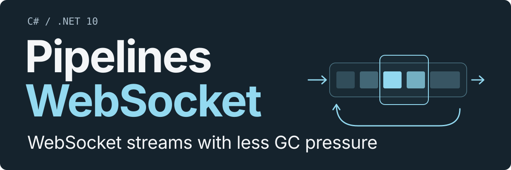

<p align="center"><strong>English</strong> · <a href="README.ru.md">Русский</a> · <a href="https://github.com/mzaprudin/pipelines-websocket/actions/workflows/ci.yml">CI</a></p>

<h1></h1>

A C# / .NET 10 WebSocket client for continuous reception with **near-zero allocations**. System.IO.Pipelines reuses receive buffers and hands unfragmented messages directly to the handler. The goal is less GC pressure and more predictable processing under sustained load.

[Ethernet measurements](#websocket-over-physical-ethernet) · [Memory reuse](#receive-from-pooled-memory) · [Run the example](#build-and-run-the-example)

## WebSocket over physical Ethernet

**128-byte JSON · 20 frames/write · 10 connections · 1-Gbit Ethernet.** Windows generator → Linux receiver. Medians of three runs, with 5 s warmup and 30 s measurement.

In the November 10 paired run, throughput and CPU cost are similar. The main measured result is **near-zero receiver-process allocations**.

<!-- ETHERNET_RESULTS_START -->
`ClientWebSocket` → `Pipelines`: **95.6 → 0.6 kB allocated per million messages** in this Ethernet profile.

| Client | Messages/s | CPU ms / 1M messages | Allocated kB / 1M messages |
|---|---:|---:|---:|
| ClientWebSocket | 802,665 | 3,732 | 95.628 |
| Pipelines · fixed 64 KiB buffer | 785,592 | 3,706 | 0.592 |

CPU and allocations cover the receiver process including sampling; 1 kB = 1000 bytes.

*On .NET 10.0.14, profiling found `StateMachineBox` allocations in ClientWebSocket's receive path on pool cache misses ([analysis and traces](results/streaming/20261110T205733Z/README.md#allocation-traces)).*

<!-- ETHERNET_RESULTS_END -->

Measured November 10, 2026: [matched Ethernet/loopback run and allocation traces](results/streaming/20261110T205733Z/README.md), [source revision](https://github.com/mzaprudin/pipelines-websocket/tree/d35c490b8dd6121a471b6ee06d63d73c4c12bbef). Historical November 8 controls: [128-byte fixed/automatic buffer matrix](results/lan-controls/20261108T202415Z/README.md) (automatic sizing used a separate experimental build) and [one-KiB matrix](results/lan-controls/20261108T194624Z/README.md).

### Ethernet: 1 KiB JSON, one frame per write

<!-- LAN_RESULTS_START -->
| Client | Messages/s | Payload Mbit/s | CPU ms / 1M messages | Allocated kB / 1M messages | GC 0/1/2 |
|---|---:|---:|---:|---:|---:|
| ClientWebSocket | 101,373 | 830.5 | 30,981 | 114.793 | 0/0/0 |
| Pipelines | 96,201 | 788.1 | 30,210 | 7.715 | 0/0/0 |

Allocations are normalized to 1,000,000 messages; 1 kB = 1000 bytes. GC shows observed collections.

Medians of three runs: 10 connections, 10 s warmup and 60 s measurement; one frame per write. CPU, allocations and GC cover the Linux receiver process, including metric sampling.

[Full results and conditions](results/lan-1kib/20261108T191616Z/README.md) · [JSON](results/lan-1kib/20261108T191616Z/summary.json)
<!-- LAN_RESULTS_END -->

## Receive from pooled memory

The receive path follows a **zero-allocation approach**: a warmed, unfragmented message needs no separate payload array. The handler borrows its bytes until its callback completes. Connection setup, pool growth and fragment assembly have separate allocation costs.

The public client is `FastWebSocketClient`; application callbacks implement `IWebSocketMessageHandler`. [Payload lifetime and framing limits](docs/architecture.md).

### Engineering decisions

- **Make memory lifetime explicit.** An unfragmented payload is a borrowed `ReadOnlySequence<byte>`; the Pipe releases storage after the handler completes. Data kept longer is copied by the application.
- **Bound incoming work.** Fragmented messages use a separate assembly path with a 1 MiB limit. Pipe backpressure thresholds allow a complete frame to arrive without stalling the producer.
- **Own connection shutdown.** Cancellable fill/read loops and serialized sends have a single lifecycle owner. Shutdown observes both loop tasks.
- **Validate the protocol.** The HTTP upgrade, frame boundaries and control traffic are checked; TLS uses normal certificate validation. ClientWebSocket provides the benchmark reference.

## Local streaming benchmark

AMD Ryzen 9 5950X · Ubuntu 24.04 · .NET 10.0.14 · Release/x64.

<!-- LOCAL_RESULTS_START -->
### Continuous reception on loopback

128-byte JSON · 20 frames/write · 10 connections · 5 s warmup / 30 s measurement. Medians of 3 fresh processes per client. The server runs in a separate local process. CPU, GC and allocations: receiver process, including sampling.

| Client | Messages/s | CPU ms / 1M messages | Allocated kB / 1M messages |
|---|---:|---:|---:|
| ClientWebSocket | 29,421,536 | 427 | 0.524 |
| Pipelines | 54,595,868 | 237 | 0.009 |

<!-- LOCAL_RESULTS_END -->

[Raw streaming reports and allocation traces](results/streaming/20261110T205733Z/) · [Measurement methodology and reproduction](docs/benchmark-methodology.md)

Run the same streaming comparison locally or against an external generator:

```sh
python3 scripts/streaming_benchmarks.py
python3 scripts/streaming_benchmarks.py --url ws://GENERATOR-IP:5050
```

## Build and run the example

Requires the .NET 10 SDK:

```sh
dotnet restore Pipelines.WebSockets.sln --locked-mode
dotnet build Pipelines.WebSockets.sln -c Release --no-restore
dotnet test tests/Pipelines.WebSockets.Tests -c Release --no-build
dotnet run -c Release --no-build --project samples/Pipelines.WebSockets.Demo
```

The [example](samples/Pipelines.WebSockets.Demo/Program.cs) sends 100 numbered messages through Pipelines and the ClientWebSocket adapter, checking every byte and message order. Tests use real local TCP/TLS peers to exercise frame sizes, fragmentation, invalid upgrades, cancellation and certificate trust. Linux and Windows CI also check benchmark setups and streaming; Windows builds and runs the portable generator.

## Documentation

[Memory ownership and limits](docs/architecture.md) · [Development](docs/development.md) · [Verification](docs/verification.md) · [Windows LAN generator](docs/lan-benchmark.md) · [Source and measurement provenance](docs/provenance.md)

Published for portfolio review without an open-source license. See [NOTICE](NOTICE).
